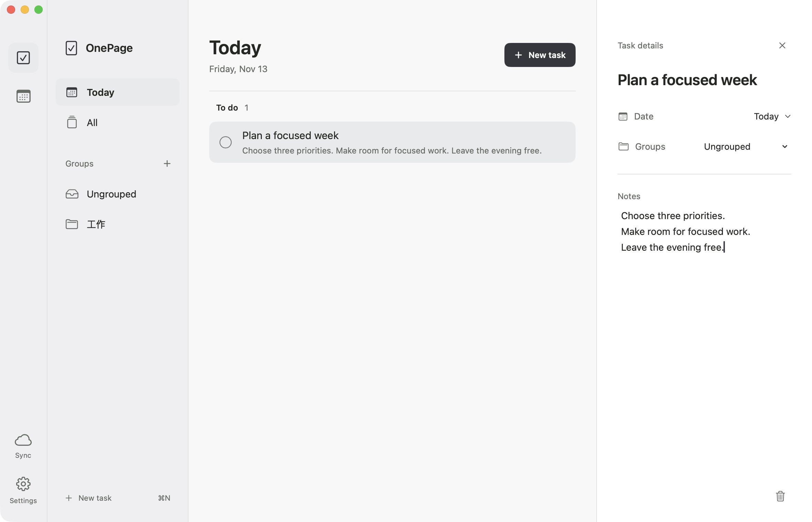
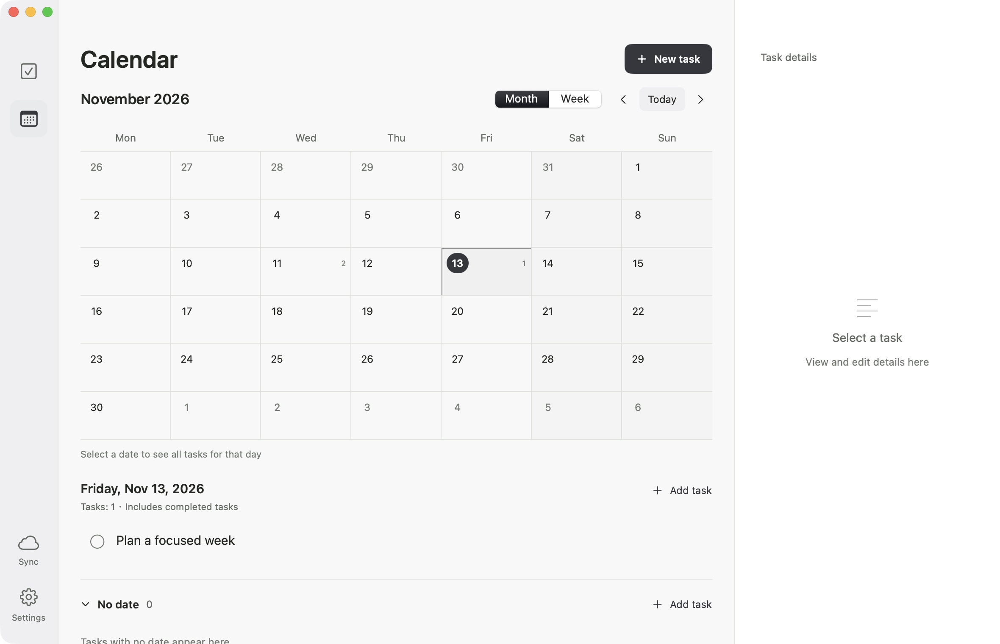
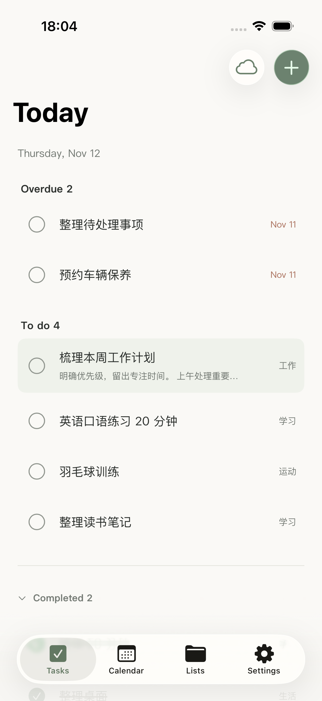

<div align="center">

[简体中文](README.md) · **English**


# OnePage · 一页待办

### A clearer day. A little more room to focus.

A calm, lightweight native to-do app.<br />
Capture what matters, give it a date, and find your own rhythm—one page at a time.

<p>
  
  
  
  
</p>

[A closer look](#a-closer-look) · [Features](#features) · [Get started](#get-started) · [Data and sync](#data-and-sync)

</div>

<br />



<p align="center"><sub>Soft backgrounds, clear hierarchy, and room to breathe. Your tasks take center stage.</sub></p>

## A comfortable home for everyday plans

A work project, a reading note, a workout, or something you just remembered—open OnePage, write it down, and take it from there.

Organize your plans in a spacious three-column layout on Mac. Capture and review tasks on iPhone. Lists help you focus on now; the calendar helps you see what comes next.

## Features

| | Make planning feel natural |
| :--- | :--- |
| **Start with today** | See today's to-dos and overdue tasks together. Finished items move into the completed section. |
| **A place for every task** | Create your own groups. On Mac, drag a task into a group to organize it. |
| **Give your plans a date** | Set task dates, explore month and week views, and see the tasks for a selected day. |
| **Select and edit** | Edit a task's title, date, group, and details in the Mac detail pane while keeping your list in view. |
| **Find your favorite palette** | Choose from Graphite, Sage, Slate Blue, Warm Clay, and Smoky Purple, with subtle dividers and generous spacing. |
| **English and 简体中文** | Choose English, Simplified Chinese, or follow your system language. |
| **Saved on your device** | Tasks and groups are stored locally. A CloudKit sync implementation is included and can be enabled after configuration. |

## A closer look

### Mac · From a single day to the whole month

Use the task list to work through individual items and the calendar to understand your schedule. A different view can make the next step clearer.



### iPhone · Capture a thought wherever you are

Tasks, Calendar, Lists, and Settings stay within easy reach.

<p align="center">
  
</p>

<p align="center"><sub>Mac screenshots were captured from the app in English. The iPhone image is an archived English-interface screenshot. Task and group names are user content and are not automatically translated. Appearance varies by version, theme, and OS.</sub></p>

## Get started

Build and run OnePage from source. The Mac app requires macOS 14 or later and an Xcode / Swift toolchain with Swift 6 support. The iPhone project targets iOS 17 or later.

### Run on Mac

```sh
git clone https://github.com/wcxdell/one-page-todo.git
cd one-page-todo
bash build.sh
open "build/一页待办.app"
```

Cloning a private repository requires an authorized GitHub account. The build script generates the app icon, packages the `.app`, and uses local ad hoc signing by default.

### Run on iPhone or in the simulator

1. Open `iOS/OnePageiOS.xcodeproj` in Xcode.
2. Select the `OnePageiOS` scheme and a simulator or device.
3. Click Run. For a physical device, configure your own developer signing first.

### Two useful Mac shortcuts

| Shortcut | Action |
| :--- | :--- |
| `⌘ N` | Create a task |
| `⌘ ⇧ Z` | Undo the last in-app operation |

## Data and sync

**Local storage is the default. iCloud sync requires additional setup.** CloudKit is disabled in the repository's current macOS configuration. Building the app alone does not enable cross-device sync.

On Mac, task data is stored at:

```text
~/Library/Application Support/OnePage/tasks.json
```

<details>
<summary><strong>Configure iCloud sync for your own build</strong></summary>

You need an active Apple Developer membership, a shared CloudKit container for the Mac and iPhone apps, and the appropriate iCloud and push notification capabilities in their signing configurations. Devices must also be signed in to iCloud.

For macOS, configure `OnePageCloudKitEnabled` and `OnePageCloudKitContainerIdentifier` in `Info.plist`, then provide these environment variables to the build script:

| Environment variable | Purpose |
| :--- | :--- |
| `ONEPAGE_SIGNING_IDENTITY` | Developer signing certificate name |
| `ONEPAGE_ENTITLEMENTS_FILE` | Path to an entitlements file matching the container and push capabilities |
| `ONEPAGE_PROVISIONING_PROFILE` | Path to the matching Mac provisioning profile |

See [`build.sh`](build.sh) for the build entry point and [`CloudSync.swift`](Sources/OnePage/CloudSync.swift) for the sync implementation. The iOS app also needs matching container and signing capabilities.

</details>

## Project structure

```text
OnePage
├── Sources/OnePage/       # Mac UI, data models, themes, localization, and sync
├── Assets/                # Mac app icon
├── Tests/OnePageTests/    # Swift Package tests
├── iOS/                   # iPhone UI, Xcode project, assets, and tests
├── docs/images/           # README screenshots
├── Package.swift          # Swift Package configuration
└── build.sh               # Mac build and packaging script
```

The repository contains source code, assets, and documentation. Local task data, signing credentials, build outputs, and historical backups are excluded from version control.

---

<p align="center">
  <strong>OnePage</strong><br />
  <sub>Write down today. Leave room for life.</sub>
</p>
