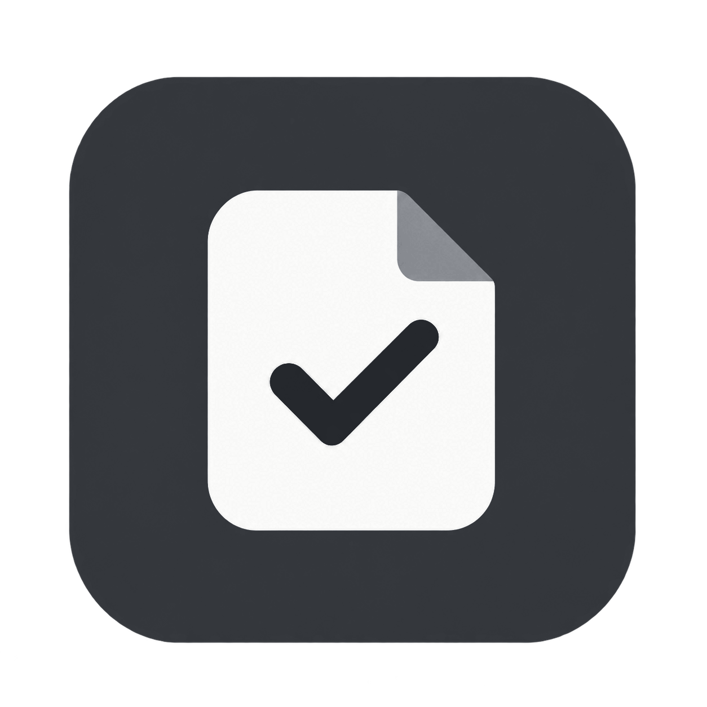
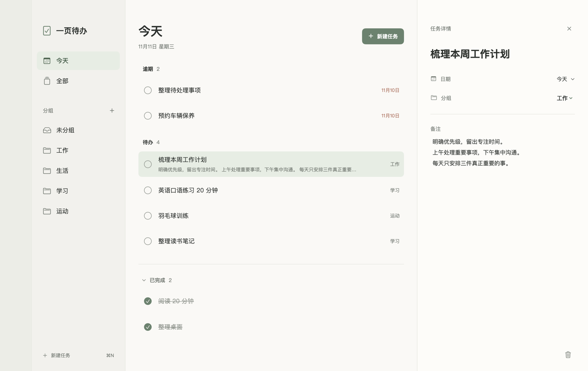
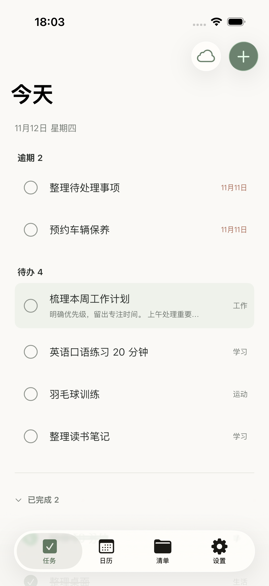

<div align="center">

**简体中文** · [English](README.en.md)



# 一页待办 · OnePage

### 把日子理清，把注意力留给眼前。

一款轻盈、安静的原生待办应用。<br />
记下要做的事，安排合适的日期，在一页之间找到自己的节奏。

<p>
  
  
  
  
</p>

[界面一览](#界面一览) · [功能特色](#功能特色) · [开始使用](#开始使用) · [数据与同步](#数据与同步)

</div>

<br />



<p align="center"><sub>柔和的底色、清楚的层次、恰到好处的留白。让任务成为视线的中心。</sub></p>

## 为每天的小事，留一个舒服的位置

工作计划、读书笔记、运动安排，或者一件突然想起的小事——打开一页待办，记下来，再慢慢完成。

在 Mac 上，用宽敞的三栏布局整理计划；在 iPhone 上，随手记录和查看。清单帮你聚焦当下，日历帮你看见接下来的安排。

## 功能特色

| | 让整理更顺手 |
| :--- | :--- |
| **今天，先做这些** | 在今天视图中查看待办与逾期任务，完成后收进已完成列表。 |
| **每件事，各有归处** | 创建自己的任务分组；在 Mac 上拖动任务，就能移入相应分组。 |
| **安排日期，看见节奏** | 为任务选择日期，通过月历、周历浏览安排，查看某一天的任务。 |
| **选中，即可编辑** | Mac 右侧详情区直接编辑标题、日期、分组与详细信息，保持当前清单上下文。 |
| **喜欢的颜色，舒服的界面** | 石墨、灰绿、岩蓝、暖陶棕、烟紫五套主题，搭配克制的线条与留白。 |
| **中文与 English** | 支持简体中文、英文，也可以跟随系统语言。 |
| **先记下来，本地保存** | 任务与分组保存在本机；项目包含 CloudKit 同步实现，可在完成配置后启用。 |

## 界面一览

### Mac · 展开一天，也展开整个月

任务列表适合逐项处理，日历适合查看时间安排。切换视角，让计划更清楚。


### iPhone · 随手记下，随时查看

任务、日历、清单与设置，放在触手可及的位置。

<p align="center">
  
</p>

<p align="center"><sub>以上为项目已有版本的运行截图；实际界面会随版本、主题及系统有所变化。</sub></p>

## 开始使用

当前通过源码构建运行。Mac 需要 macOS 14 或更新版本，以及支持 Swift 6 的 Xcode / Swift 工具链；iPhone 工程的最低系统版本为 iOS 17。

### 在 Mac 上运行

```sh
git clone https://github.com/wcxdell/one-page-todo.git
cd one-page-todo
bash build.sh
open "build/一页待办.app"
```

仓库为私有时，克隆需要已获授权的 GitHub 账户。构建脚本会生成应用图标、打包 `.app`，并默认使用本地临时签名。

### 在 iPhone 或模拟器上运行

1. 使用 Xcode 打开 `iOS/OnePageiOS.xcodeproj`。
2. 选择 `OnePageiOS` scheme 和目标模拟器或设备。
3. 点击 Run；真机运行前配置自己的开发者签名。

### 两个顺手的 Mac 快捷键

| 快捷键 | 操作 |
| :--- | :--- |
| `⌘ N` | 新建任务 |
| `⌘ ⇧ Z` | 撤销上次应用内操作 |

## 数据与同步

**默认本地保存，iCloud 同步需另行配置。** 当前仓库中的 macOS 配置未启用 CloudKit，不会仅因完成构建就自动开启跨设备同步。

Mac 任务数据保存在：

```text
~/Library/Application Support/OnePage/tasks.json
```

<details>
<summary><strong>为自己的构建配置 iCloud 同步</strong></summary>

需要有效的 Apple Developer 会员资格，为 Mac 与 iPhone 配置同一个 CloudKit 容器，并在应用签名中启用对应的 iCloud 与推送能力。设备也需要登录 iCloud。

macOS 构建需设置 `Info.plist` 中的 `OnePageCloudKitEnabled` 和 `OnePageCloudKitContainerIdentifier`，并为构建脚本提供以下环境变量：

| 环境变量 | 用途 |
| :--- | :--- |
| `ONEPAGE_SIGNING_IDENTITY` | 开发者签名证书名称 |
| `ONEPAGE_ENTITLEMENTS_FILE` | 匹配容器及推送能力的 entitlements 文件路径 |
| `ONEPAGE_PROVISIONING_PROFILE` | 对应的 Mac 描述文件路径 |

具体构建入口见 [`build.sh`](build.sh)，同步实现见 [`CloudSync.swift`](Sources/OnePage/CloudSync.swift)。iOS 端也需配置匹配的容器与签名能力。

</details>

## 项目结构

```text
OnePage
├── Sources/OnePage/       # Mac 界面、数据模型、主题、语言与同步逻辑
├── Assets/                # Mac 应用图标
├── Tests/OnePageTests/    # Swift Package 测试
├── iOS/                   # iPhone 界面、Xcode 工程、资源与测试
├── docs/images/           # README 界面预览
├── Package.swift          # Swift Package 配置
└── build.sh               # Mac 应用构建与打包
```

仓库仅保存项目源码、资源与文档；本地任务数据、签名凭据、编译产物和历史备份不纳入版本管理。

---

<p align="center">
  <strong>一页待办</strong><br />
  <sub>记下今天，留白给生活。</sub>
</p>
